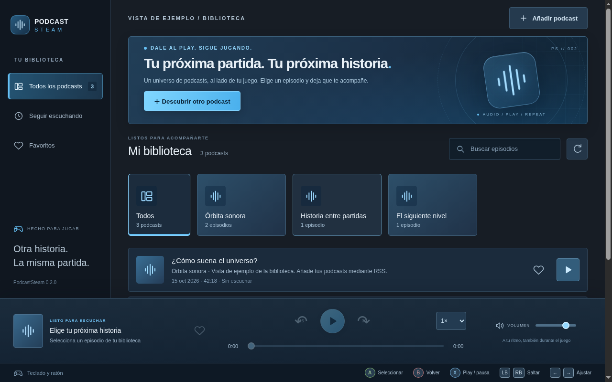

# PodcastSteam

Un reproductor de podcasts públicos por RSS para acompañar tus partidas. Aplicación de escritorio en español con Electron, orientada a Windows, macOS y SteamOS. Es una aplicación independiente que puedes añadir a Steam como producto ajeno a Steam; no modifica el cliente de Steam ni requiere su API.

La versión 0.2.0 presenta una interfaz inspirada en Steam: azul oscuro, tarjetas de biblioteca, controles amplios y foco de alto contraste para mando. La captura utiliza contenido de ejemplo, que no se añade a tu biblioteca.



## Desarrollo

Necesitas Node.js 24 y npm. Usa el checkout existente: cada tarea en la nube ya tiene su entorno aislado y no necesita un worktree.

```bash
npm ci
npm start
```

Añade la URL RSS pública de un podcast desde **Añadir podcast**. Las páginas de Spotify o Apple Podcasts no son enlaces RSS. La app descarga los metadatos y reproduce el audio desde el proveedor; necesita conexión a Internet. No incluye descargas, cuentas ni contenido exclusivo de servicios de pago.

### Funciones

- Biblioteca RSS, actualización manual y búsqueda de episodios.
- Reproducción, pausa, saltos de −15/+30 segundos, volumen independiente y velocidad de 0,75× a 2×.
- Favoritos, episodios empezados y reanudación de la posición. La app se abre pausada para evitar audio inesperado.
- Guardado local de biblioteca, posición, velocidad y volumen en el perfil de Electron. No hay sincronización entre dispositivos.
- La reproducción continúa al minimizar u ocultar la ventana. En Windows/macOS, cerrar la ventana la oculta en la bandeja; **Salir** en la bandeja termina la aplicación. En Linux, cerrar la ventana termina la aplicación: minimízala o cambia al juego para conservar el audio.
- Teclas multimedia compatibles con Media Session, según el sistema. Espacio reproduce/pausa y las flechas izquierda/derecha saltan cuando el foco no está en un campo o botón.
- Mando con mapeo estándar: la cruceta navega según la posición visual de los controles, A activa, B cierra el diálogo o vuelve a la biblioteca, X reproduce/pausa y LB/RB saltan. Al enfocar el volumen, la posición o la velocidad, izquierda/derecha ajustan su valor. El foco se conserva al cambiar favoritos o seleccionar tarjetas, y una barra inferior muestra las acciones disponibles. La app atiende al mando solo con su ventana enfocada. Steam Input debe permitir entrada de mando estándar o mapear las teclas; la integración física con Steam Deck sigue pendiente de prueba. Introduce el RSS con teclado o con el teclado en pantalla del sistema.

El código del renderer no tiene acceso a Node.js. Los RSS se leen mediante una API limitada, el texto remoto se inserta sin HTML y solo se aceptan URLs de audio HTTP/HTTPS. Los proveedores reciben peticiones normales de RSS/audio/portadas, con la información de conexión habitual. Los feeds están limitados a 5 MB y las peticiones de RSS a 20 segundos.

## Usarlo junto a Steam

1. Genera o instala el paquete nativo de tu sistema.
2. En Steam, selecciona **Añadir un producto → Añadir un producto que no es de Steam** y elige PodcastSteam. En Steam Deck, hazlo desde el modo Escritorio. Para AppImage, concede permiso de ejecución antes de añadirla (`chmod +x PodcastSteam-*.AppImage`).
3. Abre PodcastSteam desde la biblioteca, añade un RSS e inicia un episodio.
4. Cambia a Steam y abre el juego sin cerrar PodcastSteam. Ajusta el volumen del podcast en su reproductor y el del juego en sus opciones o en el mezclador del sistema.
5. En Steam Deck, vuelve al modo Juego y prueba abrir primero PodcastSteam y después el juego. Cambia entre aplicaciones desde el menú Steam; los controles del podcast requieren enfocarlo.

**Pendiente de validación en hardware:** la ejecución simultánea desde el modo Juego de SteamOS, Steam Input, suspensión/reanudación de Steam Deck, rendimiento durante juegos y teclas multimedia por sistema. El audio avanzando con la ventana oculta sí se ha comprobado en Electron/Linux con un episodio WAV de prueba. No equivale a una prueba con un juego ni garantiza todavía la compatibilidad de las tres plataformas. Si el modo Juego impide el uso simultáneo, el modo Escritorio es la alternativa que se debe comprobar.

En Linux hace falta un entorno gráfico y la configuración de sandbox que requiere Electron en la distribución. Si aparece un error de `chrome-sandbox`, resuelve los permisos o la configuración de namespaces según la distribución; los paquetes para uso habitual no desactivan el sandbox.

## Pruebas

```bash
npm test
npm run test:e2e
```

Las pruebas unitarias comprueban RSS, metadatos, URLs, errores HTTP, redirecciones y límites de tamaño. La prueba de escritorio abre Electron y un servidor HTTP local con audio PCM real: comprueba errores al añadir un RSS, aislamiento de Node, favoritos, reproducción, saltos, velocidad, volumen, avance con ventana oculta, reinicio con reanudación, búsqueda y controles de teclado/mando simulado. No depende de un proveedor externo. Necesita una pantalla gráfica; en Linux CI se usa `xvfb-run -a npm run test:e2e`.

Playwright desactiva el sandbox de Chromium para la automatización de Electron. Esto está limitado al proceso de prueba; `npm start` y los paquetes conservan su configuración normal. La prueba utiliza un perfil temporal independiente.

### Entorno Codex en la nube

```bash
cd /workspace/PodcastSteam
source scripts/cloud-env.sh
npm ci
npm test
npm run test:e2e
npm run pack
```

El helper configura cachés escribibles, el proxy de Node y una pantalla virtual local usando el Xorg/dummy ya instalado en esta máquina. Se puede volver a ejecutar y reutiliza la pantalla si está disponible. No es necesario en ordenadores personales. En este contenedor no está disponible la configuración del sandbox de escritorio de Electron: para una inspección manual aislada se puede ejecutar `npm start -- --no-sandbox`; no usar esa opción en los paquetes distribuidos. No se ofrecen enlaces web de previsualización: es una aplicación de escritorio.

La política de red de la nube permite los registros de paquetes y GitHub. Para probar podcasts externos en este entorno deben permitirse sus dominios RSS, audio y portadas en los ajustes del entorno. La validación automática usa exclusivamente un servidor local y no acredita la accesibilidad de un proveedor externo.

## Empaquetado

```bash
npm run pack  # carpeta ejecutable para el sistema actual
npm run dist  # AppImage en Linux, DMG en macOS o instalador NSIS en Windows
```

Los resultados están en `dist/`. Genera cada paquete en su sistema nativo. El workflow de GitHub Actions ejecuta las pruebas y genera los tres formatos; no se ha ejecutado desde este entorno. Para ejecutarlo, sube el repositorio a GitHub y utiliza la acción **Desktop**. No publica en Steam ni distribuye versiones automáticamente.

Los paquetes de desarrollo no están firmados ni notarizados. La distribución pública requiere certificados y configuración de firma de Windows/macOS, revisión de licencias y las pruebas de hardware pendientes. No se incluyen credenciales. La versión inicial usa el icono predeterminado de Electron para el empaquetado.

El workflow **Release Linux** publica una prerelease con AppImage y SHA256SUMS al subir una etiqueta `v*`. Ejecuta primero las pruebas y compila el paquete en GitHub. Subir una etiqueta de versión implica publicar: hazlo solo con autorización. La release `v0.1.0` fue autorizada como versión de prueba. Este flujo utiliza el token temporal de GitHub Actions, sin credenciales guardadas en el proyecto.

### Prueba en macOS

El paquete DMG universal incluye Intel (x86_64) y Apple Silicon (arm64). El workflow **Release macOS**, activado por etiquetas `macos-v*`, ejecuta las pruebas de escritorio, compila el paquete universal, comprueba ambas arquitecturas y su firma ad hoc, prueba la aplicación empaquetada y adjunta el DMG y `SHA256SUMS-macOS` a la release `v*` existente. No sustituye archivos publicados ni crea una release nueva. La etiqueta debe coincidir con la versión de package.json; admite sufijos `-retryN` para repetir una publicación fallida sin mover etiquetas existentes.

Abre el DMG y arrastra PodcastSteam a Aplicaciones. Esta versión utiliza firma ad hoc, sin certificado Developer ID ni notarización: macOS puede pedir autorización. Si la bloquea tras intentar abrirla, revisa **Ajustes del Sistema → Privacidad y seguridad → Abrir igualmente** para autorizar esta aplicación concreta. No desactives Gatekeeper globalmente. Añade un RSS, inicia un episodio, minimiza la app y abre un juego desde Steam. Comprueba que sigue sonando, que los volúmenes se pueden ajustar por separado y que la posición se recupera después de salir y abrir de nuevo. Para terminar el proceso, usa **Salir** desde el icono de la bandeja.
